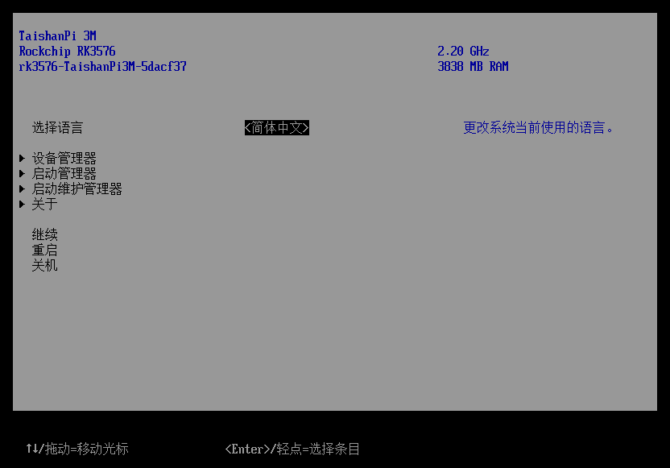
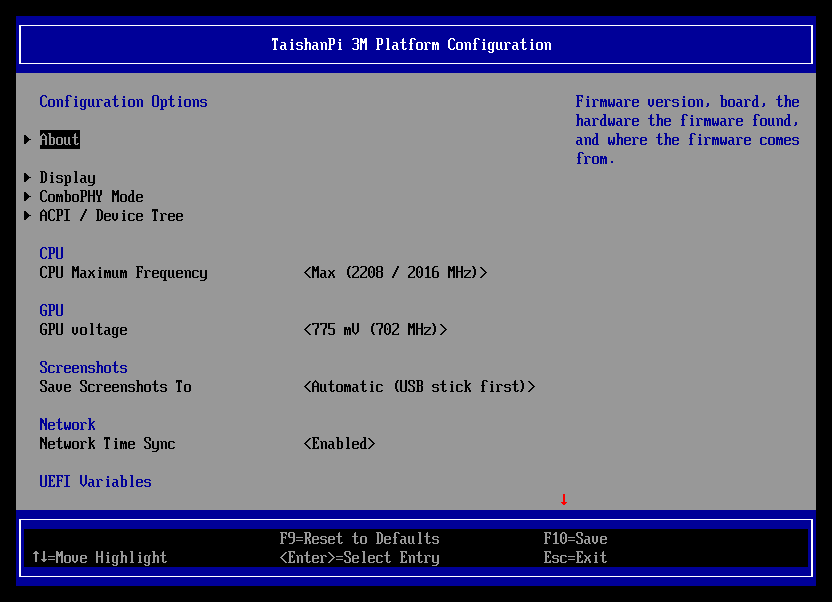

# edk2-rk3576

[]()
[](LICENSE)
[](https://flash.gahingwoo.com/)
[](https://edk2.gahingwoo.com/)

UEFI firmware (EDK2 / TianoCore) for Rockchip RK3576 boards.

```
BootROM → U-Boot SPL → TF-A BL31 → EDK2 (BL33) → OS
```

Three boards are supported: the Radxa ROCK 4D, the ArmSoM CM5-IO and the LCKFB
TaishanPi 3M. The ROCK 4D and the CM5-IO boot Fedora from NVMe. The CM5-IO and
the TaishanPi 3M boot Windows 11 23H2 from their eMMC, with the drivers from
[woa-rk3576](https://github.com/gahingwoo/woa-rk3576); see
[Windows](#windows) below.

- Images: [latest release](https://github.com/gahingwoo/edk2-rk3576/releases/latest)
- Flash from the browser: [flash.gahingwoo.com](https://flash.gahingwoo.com/)
- Docs: [edk2.gahingwoo.com](https://edk2.gahingwoo.com/)

## Gallery

| Radxa ROCK 4D | ArmSoM CM5-IO |
|---|---|
|  |  |
| Fedora 44 from NVMe | Fedora 45 from NVMe, Mali-G52 through Panfrost |
|  |  |
| UEFI front page, 2560x1440 over HDMI | UEFI front page, 2560x1440 over HDMI |

| ArmSoM CM5-IO | LCKFB TaishanPi 3M |
|---|---|
|  |  |
| Windows 11 23H2 from the eMMC | Windows 11 23H2 from the eMMC, desktop drawn on the Mali-G52 |

### Firmware menus

Screenshots of the TaishanPi 3M's DSI screen, saved by the firmware itself.
The menus are drawn in landscape on the portrait panel; they can be switched
to Simplified Chinese on the front page.

| | |
|---|---|
|  |  |
| Front page, with Shut Down and About | About: firmware build, board, clocks, what was found at boot |
|  |  |
| The same front page in Simplified Chinese | Boot Manager: eMMC, Touch Test, UEFI Shell, MaskROM, network, a USB stick |
|  |  |
| Platform configuration | Display settings |


HWiNFO on the TaishanPi 3M under Windows: eight cores, 3838 MB, the board and
firmware names from SMBIOS, the Mali-G52.

Screenshots of the firmware itself: press Ctrl+Alt+F12 on a keyboard, F12
on the serial console, or the camera key of the on-screen keyboard. The
picture is saved as `\uefi-screenshots\YYYYMMDD-HHMMSS.png` (`shot-NNNN.png` when
the clock is not set) on a FAT formatted medium. "Save Screenshots To" in
the platform setup picks where: Automatic (a USB stick first, then an SD
card, then the ESP), or only one of them. A green square flashes in the top
left corner when it is saved, yellow when there is nowhere to write, red
when it failed; the serial log has the path.

To report a problem, save a debug report: Device Manager > Debug Report, or
Ctrl+Alt+F11 (F11 on the serial console). It writes `\uefi-debug\YYYYMMDD-HHMMSS\`
to the same place: the firmware log of this boot, a summary (firmware,
board, boot options, display, PCI, USB and storage devices, memory map), the
ACPI tables, the device tree, and from Device Manager a screenshot of every
setup page. While it walks the pages, "Collecting debug report, please do
not touch anything..." stands in the top left corner. On the TaishanPi 3M a
full report from Device Manager saved 64 of the 65 setup pages to a USB
stick (the 65th is the Debug Report page itself, open underneath).

## Boards

| | Radxa ROCK 4D | ArmSoM CM5-IO | LCKFB TaishanPi 3M |
|---|---|---|---|
| Boots from | SPI NOR | eMMC or SD | eMMC, or an SPL on eMMC with the firmware on SD |
| HDMI | yes | yes | yes |
| MIPI DSI screen | not tried | not tried | LCKFB's 800x1280 screen, with touch in the menus |
| eMMC | no eMMC (UFS) | yes, UEFI variables persist | yes, UEFI variables persist |
| NVMe | yes | yes | not tried (mini-PCIe slot) |
| USB | yes | yes; USB-C is USB 2.0 in UEFI and Windows | four USB-A ports; USB-C unused |
| Ethernet | yes | yes, in UEFI, Linux and Windows | yes, in UEFI and Windows; not checked in Linux |
| Linux through UEFI | Fedora from NVMe | Fedora from NVMe | Armbian edge from the eMMC: DSI screen, touch, headphones, backlight; [details and limits](#linux-on-the-taishanpi-3m) |
| Windows 11 23H2 | not tried | boots to the desktop | boots to the desktop: GPU driver, touch, landscape, Bluetooth; no sound yet |

Serial console: 1500000 8N1.

Each board's results come from one unit.

The setup menus can be switched to Simplified Chinese on the front page. The
display, I2C and menu changes that came with the TaishanPi 3M's screen are
shared by all three boards. They were run on the TaishanPi 3M and, for the
menus over HDMI, on the CM5-IO. The ROCK 4D has not run them yet.

"Reset All Settings" on the front page, or F9 during the boot countdown
(from a serial terminal too), puts the firmware back to how a freshly
flashed board starts: it erases the whole UEFI variable store, so every
setup setting, the language, the boot options and boot order, the timeout
and any Secure Boot keys. It asks first, in a red warning with No
selected. The board restarts, the store is erased before anything reads it, and
the firmware sets itself up as on its first boot. Nothing outside the
variable store is touched. Run on the TaishanPi 3M: the settings and boot
options came back as on a new board, and the next boot did not erase
anything again. Boot options added by hand (an OS, a second loader) are
gone afterwards; `bcfg boot add` in the UEFI Shell puts them back.

### LCKFB TaishanPi 3M

The BootROM on this board only tries the eMMC, and there is no MaskROM
button: two pads marked `MSK` are shorted instead. So the first flash goes
through MaskROM, and at least the SPL has to live on the eMMC. After that the
firmware can reset into MaskROM by itself (F4 during the boot countdown). See
[Flashing](docs/FLASHING.md#lckfb-taishanpi-3m) and
[Hardware](docs/HARDWARE.md#lckfb-taishanpi-3m).

The fan connector is driven from firmware and runs at full speed.

LCKFB's 800x1280 MIPI DSI screen (part C41409463) works from power on. The
firmware looks for its touch controller on I2C0 and uses the screen when it
is there, HDMI when it is not. The ribbon must only be plugged or unplugged
with the power off.

- The firmware's menus are drawn rotated to landscape. "Screen Rotation" in
  the platform setup changes that. The rotation covers the menus, the UEFI
  Shell and the touch test. An operating system gets the panel as it is,
  portrait, and rotates it itself.
- Touch works in the menus as keys: drag moves the highlight, a tap is
  Enter, two fingers or a long press is Esc. "Touch Test" in the boot
  manager shows where touches land.
- For typing, the small keyboard key near the top right corner opens an
  on-screen keyboard; Hide on it closes it. Its keys reach setup, the UEFI
  Shell, GRUB and the Windows boot manager. The same keyboard appears on
  every board as soon as a USB mouse is plugged in, with a mouse cursor:
  the wheel is Up and Down, a left click Enter and a right click Esc
  anywhere off the keyboard. Not run on a board yet.
- Windows shows its picture on the screen. With
  [wddm-mali-g52](https://github.com/gahingwoo/wddm-mali-g52) it can be
  turned to landscape in Settings, and touch works with the GT9271 driver
  from [woa-rk3576](https://github.com/gahingwoo/woa-rk3576) (ten points).
  "Screen Brightness (%)" on the display page sets the backlight from 10 to
  100%; Windows gets a brightness slider of its own from wddm-mali-g52's
  `dsi-brightness` branch, which is not merged yet.
- "Shut Down" on the front page, `reset -s` in the UEFI Shell and a shutdown
  from Windows power the board off. The firmware switches the RK806 PMIC
  off over I2C1 itself, and arms it for the PSCI call Windows makes.

#### Linux on the TaishanPi 3M

Run on one board, with Armbian edge (Linux 7.3.4, GNOME) installed in a 6 GB
partition of the eMMC next to Windows and started through GRUB from the
boot manager. The device tree is the firmware's own: besides the mainline
board file it describes the ES8388 headphone codec, the GT9271 touchscreen,
the PWM backlight, the DSI screen (only when it is attached), the mini-PCIe
power for an EC20 modem and the GPU (disabled for now, see below). Nothing
has to be put on the ESP. The screen works two ways, chosen by "Force UEFI
GOP Display" on the ACPI / Device Tree page:

- **Off: Linux drives the screen.** The firmware stops its own picture at
  ExitBootServices so the kernel's VOP2 and DSI drivers can take over, and
  the screen shows the GNOME login. It needs a kernel with a driver for the
  panel (Armbian's rocknix generic DSI driver; mainline has none yet). GNOME
  turns it to landscape from the panel's rotation and turns touch with it.
  The screen stays dark from power on until that driver starts.
- **On: Linux keeps the firmware's picture** through simpledrm or efifb: a
  fixed 800x1280 portrait mode drawn on the CPU. GNOME cannot tie the
  touchscreen to that output, so turning it to landscape needs a matching
  `LIBINPUT_CALIBRATION_MATRIX` udev rule for the touchscreen
  (`0 -1 1 1 0 0` with the output rotated `left`). The kernel's own display
  drivers are switched off in this mode, so HDMI and HDMI audio do not work
  in Linux.

Checked on that install with the firmware's device tree: the headphones play
(through ALSA), touch, the backlight from `/sys/class/backlight` (it needs
the RK3576 PWM driver Armbian carries; mainline has none yet), the USB-A
ports, Ethernet and the EC20. The limits:

- The GPU is disabled in the device tree. Enabled, panfrost probes and then
  the kernel panics with an SError when a GPU job times out. Not understood
  yet; the leading suspect is the GPU clock under the open-source TF-A this
  firmware ships.
- Armbian's own board support does not expect UEFI yet. Its screen service
  writes a U-Boot overlay setting and restarts, which under UEFI is a loop;
  mask `lckfb-tspi-3m-screen.service`. Its ALSA UCM profile is named after
  the sound card's long name, and under UEFI the kernel names the cards
  after SMBIOS (`LCKFB-TaishanPi3M-0`) instead of `rockchip-es8388`, so
  PipeWire does not find it. With the profile linked under the new name the
  card is set up, yet GNOME's output is still silent and the microphone
  records silence. Both are being looked at.
- HDMI in Linux with force GOP off has not been tried on this board. It
  works that way on the other two.
- The USB-C port is not set up by the firmware.
- An installer will not know that Windows shares the eMMC. The Armbian
  install above was written by hand into a partition Windows made room for.

The TaishanPi 3M used for this work was sponsored by JLC (嘉立创).

## Windows

Windows 11 23H2 runs from the eMMC of the CM5-IO and of the TaishanPi 3M.
Windows 10 22H2 should also run and has not been tried. Windows 11 24H2 and
later cannot: they need ARMv8.1 and RK3576 is ARMv8.0.

Windows Setup does not work on these boards. It has no driver for the eMMC
controller, and it refuses a machine without a TPM. The image is applied with
DISM from a WinPE that carries the drivers and a script that does the rest:

1. Flash this firmware to the eMMC. On the TaishanPi 3M that is the
   `emmc` image, written at sector 0 from MaskROM.
2. Write the WinPE image from the
   [woa-rk3576 release](https://github.com/gahingwoo/woa-rk3576/releases/latest)
   to a USB stick. Add an exFAT or NTFS partition in the free space behind it
   and copy `sources\install.wim` there from a Windows 11 23H2 ARM64 ISO.
3. Take out any SD card, plug the stick into a USB-A port and boot it from
   the firmware's boot menu.
4. Run `woa-deploy\deploy-windows.cmd` from the stick. It checks that the
   disk is the eMMC with this firmware on it, asks you to type `ERASE`,
   partitions the rest of the eMMC, applies the image, adds the drivers and
   turns on test signing.
5. Remove the stick and reboot. Windows finishes its setup and reaches the
   desktop, which shows "Test Mode".

The full procedure, the reasons for each step and what to do when it does not
boot are in
[woa-rk3576's INSTALL.md](https://github.com/gahingwoo/woa-rk3576/blob/main/docs/INSTALL.md).
Do not make this stick with Ventoy: with the WinPE image its UDF driver
stopped with a synchronous exception. Ventoy itself does start on this
firmware, and has handed over to a Linux disk image once.

Out of the box the desktop is drawn on the CPU into the firmware's
framebuffer, at the one mode the firmware set.
[wddm-mali-g52](https://github.com/gahingwoo/wddm-mali-g52) is a display
driver for the Mali-G52 that moves the desktop onto the GPU. It is an early
driver, built by that repository's CI and without a release, and has run on
the TaishanPi 3M only.

Bluetooth works under Windows on the TaishanPi 3M: the firmware declares the
module's controller on UART6 (`ACPI\RKCP4345`), and sets its pins and clock.
The module runs from the RTC chip's 32 kHz output, which is on as the chip
leaves the factory; the driver is
[bcm4345bt](https://github.com/gahingwoo/woa-rk3576/tree/main/drivers/bluetooth/bcm4345bt)
in woa-rk3576. Pairing and file transfer work; voice (SCO) does not yet.

Not working under Windows on either board: audio and WiFi, and Bluetooth on
the CM5-IO. The TaishanPi 3M's audio drivers load, but its SAI never starts sending; a fix
is in progress in woa-rk3576. The board's RTC chip holds no valid time, so
the clock is wrong after every boot until Windows syncs it; set
`HKLM\SYSTEM\CurrentControlSet\Control\TimeZoneInformation\RealTimeIsUniversal`
to 1 so Windows reads the firmware's clock as UTC. A wrong clock also makes
test-signed drivers look "not yet valid" to pnputil.

## Known issues

- Windows 11 24H2 and later cannot run: RK3576 is ARMv8.0. Use Windows 10 or
  11 23H2.
- Boot entries written from an OS (`efibootmgr`, `bcdboot`) do not reach the
  firmware, and Linux logs `Unable to handle paging request in EFI runtime
  service` at reboot. Windows boots through `\EFI\Boot\bootaa64.efi` instead.
- On the ROCK 4D and the CM5-IO the USB-C port runs at USB 2.0 outside
  Linux. The firmware brings up the USBDP PHY's USB3 half at
  ExitBootServices (on the CM5-IO it reads the plug orientation from the
  FUSB302), which stopped Windows bugchecking at shutdown, but SuperSpeed
  has not trained there: DRD0's link stays in Rx.Detect. On the TaishanPi 3M
  the firmware does not use the USB-C port at all.
- The 0.4.0 image for the ROCK 4D has not been run on a ROCK 4D yet. What
  changed since 0.2.1 is code the three boards share, and it has run on the
  other two. On the CM5-IO, 0.4.0 has shown its menus and has not started an
  operating system yet.
- The release images are built from `main`. Some of what is in them has
  booted without being checked for what it is meant to do; that is listed in
  [Hardware](docs/HARDWARE.md#lckfb-taishanpi-3m).
- The ComboPHY and PCIe device-tree fixups look for `/pcie@…` at the root,
  where mainline has `/soc/`, so they do nothing. NVMe works without them.
- The TaishanPi 3M's RTC (HYM8563) holds no valid time, so the firmware's
  clock, and the names of screenshots and debug reports, are wrong until an
  OS sets it. Linux logs `rtc-hym8563: no valid clock/calendar values`.

## Build

```bash
scripts/setup-host.sh
scripts/build.sh   cm5io
scripts/package.sh cm5io      # -> out/CM5IO/CM5IO-sdcard.img
```

[Building](docs/BUILDING.md) · [Flashing](docs/FLASHING.md) ·
[Image layout](docs/SPI_LAYOUT.md) · [Hardware](docs/HARDWARE.md)

## Layout

```
Platform/ArmSoM/CM5IO/       board package: DSC, PMIC/GPIO/PHY glue, ACPI, DTS
Platform/Radxa/ROCK4D/
Platform/LCKFB/TaishanPi3M/
Silicon/Rockchip/RK3576/     SoC package: RK3576Base.dsc.inc, FDF, ACPI, drivers
Silicon/Rockchip/            drivers shared across Rockchip SoCs
Silicon/Synopsys/DesignWare/ DWC EQoS and DWC MMC
boards/                      one .conf per board
scripts/                     setup-host, build, package
patches/                     patches to the TianoCore core, applied at setup
binaries/                    BL31, DDR init blob, SPL
devicetree/mainline/         board DTS
docs/                        the site at edk2.gahingwoo.com
```

A board DSC holds only what differs between boards. Everything the SoC decides
is in `Silicon/Rockchip/RK3576/RK3576Base.dsc.inc`.

Before 2026-08-04 this tree was a copy of edk2-rockchip that built RK3576 on
top of RK3588's configuration. That version is on the `legacy/v0.1` branch.

## Acknowledgements

Thanks to [JLC](https://jlc.com/) (嘉立创) for sponsoring the LCKFB TaishanPi 3M, its MIPI DSI screen, the fan and the EC20 4G module used for this work, and to [ArmSoM](https://www.armsom.org/) for sponsoring the CM5 module and the CM5-IO board.

## Licence

BSD-2-Clause-Patent, like TianoCore and edk2-rockchip. Code taken from Linux,
U-Boot and Rockchip keeps its own licence; [LICENSE](LICENSE) lists those files.
