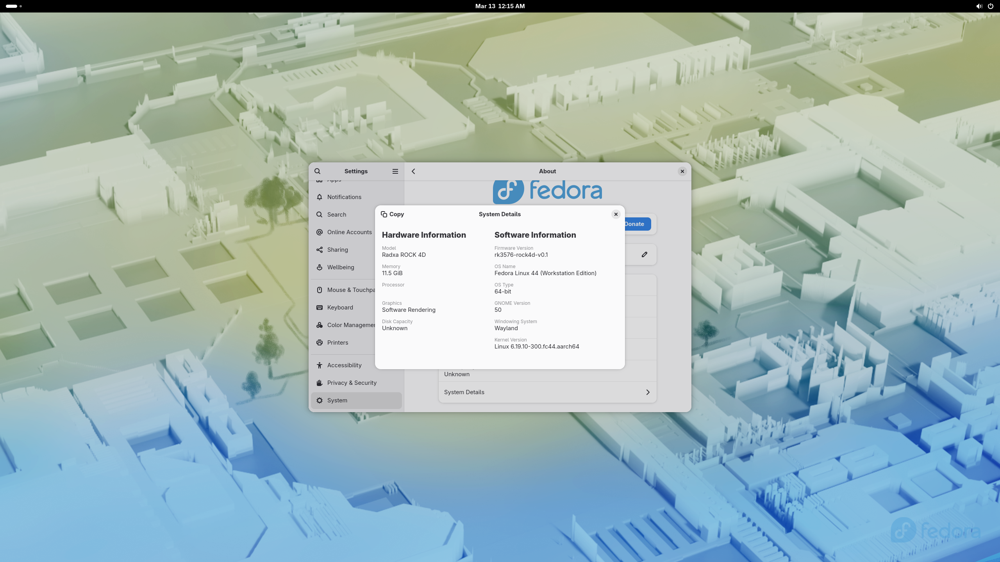
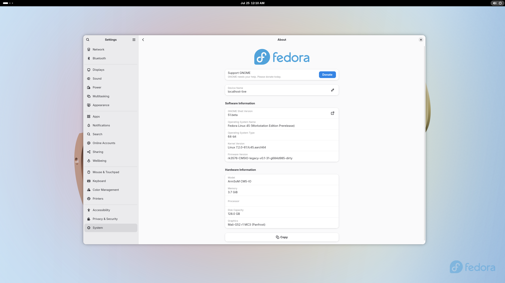
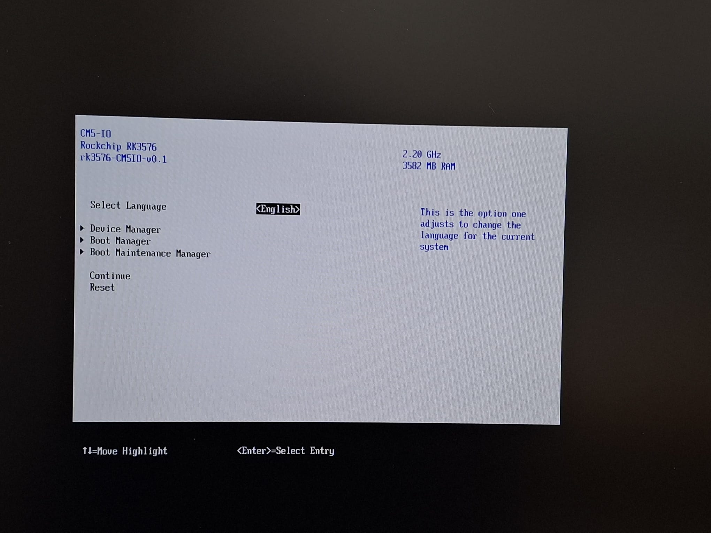
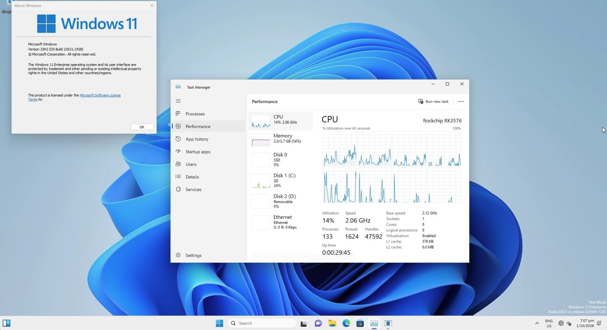
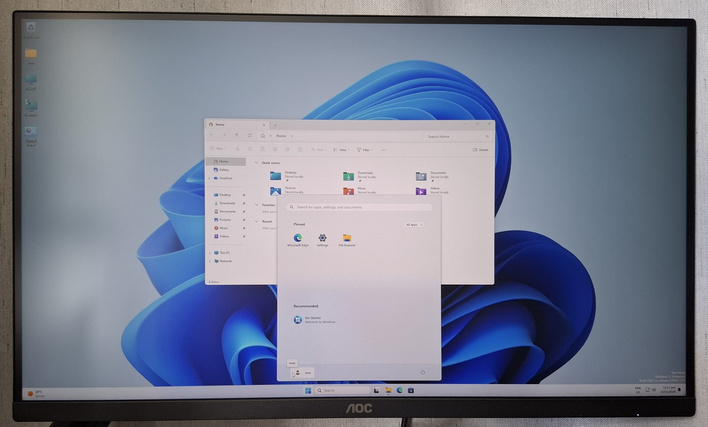

# edk2-rk3576

[]()
[](LICENSE)
[](https://flash.gahingwoo.com/)
[](https://edk2.gahingwoo.com/)

UEFI firmware (EDK2 / TianoCore) for Rockchip RK3576 boards.

```
BootROM → U-Boot SPL → TF-A BL31 → EDK2 (BL33) → OS
```

Three boards are supported: the Radxa ROCK 4D, the ArmSoM CM5-IO and the LCKFB
TaishanPi 3M. The ROCK 4D and the CM5-IO boot Fedora from NVMe. The CM5-IO and
the TaishanPi 3M boot Windows 11 23H2 from their eMMC, with the drivers from
[woa-rk3576](https://github.com/gahingwoo/woa-rk3576); see
[Windows](#windows) below.

- Images: [latest release](https://github.com/gahingwoo/edk2-rk3576/releases/latest)
  for the ROCK 4D and the CM5-IO, the
  [0.3.0-tspi3m.1 pre-release](https://github.com/gahingwoo/edk2-rk3576/releases/tag/0.3.0-tspi3m.1)
  for the TaishanPi 3M
- Flash from the browser: [flash.gahingwoo.com](https://flash.gahingwoo.com/)
- Docs: [edk2.gahingwoo.com](https://edk2.gahingwoo.com/)

## Gallery

| Radxa ROCK 4D | ArmSoM CM5-IO |
|---|---|
|  |  |
| Fedora 44 from NVMe | Fedora 45 from NVMe, Mali-G52 through Panfrost |
|  |  |
| UEFI front page, 2560x1440 over HDMI | UEFI front page, 2560x1440 over HDMI |

| ArmSoM CM5-IO | LCKFB TaishanPi 3M |
|---|---|
|  |  |
| Windows 11 23H2 from the eMMC | Windows 11 23H2 from the eMMC, desktop drawn on the Mali-G52 |

## Boards

| | Radxa ROCK 4D | ArmSoM CM5-IO | LCKFB TaishanPi 3M |
|---|---|---|---|
| Boots from | SPI NOR | eMMC or SD | eMMC, or an SPL on eMMC with the firmware on SD |
| HDMI | yes | yes | yes |
| eMMC | no eMMC (UFS) | yes, UEFI variables persist | yes, UEFI variables persist |
| NVMe | yes | yes | not tried (mini-PCIe slot) |
| USB | yes | yes; USB-C is USB 2.0 in UEFI and Windows | four USB-A ports; USB-C unused |
| Ethernet | yes | yes, in UEFI, Linux and Windows | yes, in UEFI and Windows |
| Linux through UEFI | Fedora from NVMe | Fedora from NVMe | not tried |
| Windows 11 23H2 | not tried | boots to the desktop | boots to the desktop, GPU driver available |

Serial console: 1500000 8N1.

Each board's results come from one unit.

### LCKFB TaishanPi 3M

The BootROM on this board only tries the eMMC, and there is no MaskROM
button: two pads marked `MSK` are shorted instead. So the first flash goes
through MaskROM, and at least the SPL has to live on the eMMC. After that the
firmware can reset into MaskROM by itself (F4 during the boot countdown). See
[Flashing](docs/FLASHING.md#lckfb-taishanpi-3m) and
[Hardware](docs/HARDWARE.md#lckfb-taishanpi-3m).

The fan connector is driven from firmware and runs at full speed. The
TaishanPi 3M has no full release yet; its images are in the pre-release
linked above.

The TaishanPi 3M used for this work was provided by LCKFB.

## Windows

Windows 11 23H2 runs from the eMMC of the CM5-IO and of the TaishanPi 3M.
Windows 10 22H2 should also run and has not been tried. Windows 11 24H2 and
later cannot: they need ARMv8.1 and RK3576 is ARMv8.0.

Windows Setup does not work on these boards. It has no driver for the eMMC
controller, and it refuses a machine without a TPM. The image is applied with
DISM from a WinPE that carries the drivers and a script that does the rest:

1. Flash this firmware to the eMMC. On the TaishanPi 3M that is the
   `emmc` image ("Option A" in the pre-release notes).
2. Write the WinPE image from the
   [woa-rk3576 release](https://github.com/gahingwoo/woa-rk3576/releases/latest)
   to a USB stick. Add an exFAT or NTFS partition in the free space behind it
   and copy `sources\install.wim` there from a Windows 11 23H2 ARM64 ISO.
3. Take out any SD card, plug the stick into a USB-A port and boot it from
   the firmware's boot menu.
4. Run `woa-deploy\deploy-windows.cmd` from the stick. It checks that the
   disk is the eMMC with this firmware on it, asks you to type `ERASE`,
   partitions the rest of the eMMC, applies the image, adds the drivers and
   turns on test signing.
5. Remove the stick and reboot. Windows finishes its setup and reaches the
   desktop, which shows "Test Mode".

The full procedure, the reasons for each step and what to do when it does not
boot are in
[woa-rk3576's INSTALL.md](https://github.com/gahingwoo/woa-rk3576/blob/main/docs/INSTALL.md).
Do not make the stick with Ventoy: its UDF driver stops with a synchronous
exception on RK3576.

Out of the box the desktop is drawn on the CPU into the firmware's
framebuffer, at the one mode the firmware set.
[wddm-mali-g52](https://github.com/gahingwoo/wddm-mali-g52) is a display
driver for the Mali-G52 that moves the desktop onto the GPU. It is an early
driver, built by that repository's CI and without a release, and has run on
the TaishanPi 3M only.

Not working under Windows on either board: audio, WiFi and Bluetooth. The
TaishanPi 3M has no RTC driver, so the clock is wrong until it syncs.

## Known issues

- Windows 11 24H2 and later cannot run: RK3576 is ARMv8.0. Use Windows 10 or
  11 23H2.
- Boot entries written from an OS (`efibootmgr`, `bcdboot`) do not reach the
  firmware, and Linux logs `Unable to handle paging request in EFI runtime
  service` at reboot. Windows boots through `\EFI\Boot\bootaa64.efi` instead.
- The USB-C port runs at USB 2.0 outside Linux. The firmware brings up the
  USBDP PHY's USB3 half at ExitBootServices (on the CM5-IO it reads the plug
  orientation from the FUSB302), which stopped Windows bugchecking at
  shutdown, but SuperSpeed has not trained there: DRD0's link stays in
  Rx.Detect.
- The ROCK 4D has not been tested with the Windows-related changes in 0.2.0.
- `main` is ahead of the release images. What has been merged and not yet run
  on a board is listed in [Hardware](docs/HARDWARE.md#lckfb-taishanpi-3m).
- The ComboPHY and PCIe device-tree fixups look for `/pcie@…` at the root,
  where mainline has `/soc/`, so they do nothing. NVMe works without them.

## Build

```bash
scripts/setup-host.sh
scripts/build.sh   cm5io
scripts/package.sh cm5io      # -> out/CM5IO/CM5IO-sdcard.img
```

[Building](docs/BUILDING.md) · [Flashing](docs/FLASHING.md) ·
[Image layout](docs/SPI_LAYOUT.md) · [Hardware](docs/HARDWARE.md)

## Layout

```
Platform/ArmSoM/CM5IO/       board package: DSC, PMIC/GPIO/PHY glue, ACPI, DTS
Platform/Radxa/ROCK4D/
Platform/LCKFB/TaishanPi3M/
Silicon/Rockchip/RK3576/     SoC package: RK3576Base.dsc.inc, FDF, ACPI, drivers
Silicon/Rockchip/            drivers shared across Rockchip SoCs
Silicon/Synopsys/DesignWare/ DWC EQoS and DWC MMC
boards/                      one .conf per board
scripts/                     setup-host, build, package
patches/                     patches to the TianoCore core, applied at setup
binaries/                    BL31, DDR init blob, SPL
devicetree/mainline/         board DTS
docs/                        the site at edk2.gahingwoo.com
```

A board DSC holds only what differs between boards. Everything the SoC decides
is in `Silicon/Rockchip/RK3576/RK3576Base.dsc.inc`.

Before 2026-08-04 this tree was a copy of edk2-rockchip that built RK3576 on
top of RK3588's configuration. That version is on the `legacy/v0.1` branch.

## Licence

BSD-2-Clause-Patent, like TianoCore and edk2-rockchip. Code taken from Linux,
U-Boot and Rockchip keeps its own licence; [LICENSE](LICENSE) lists those files.
