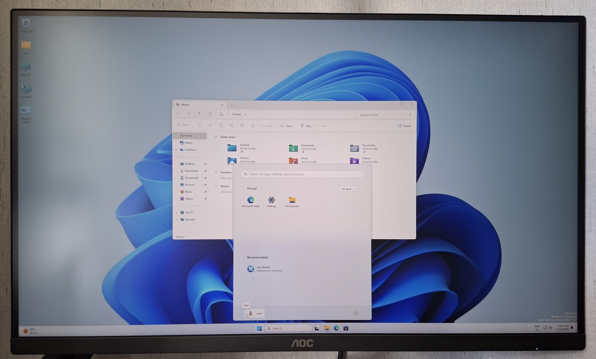
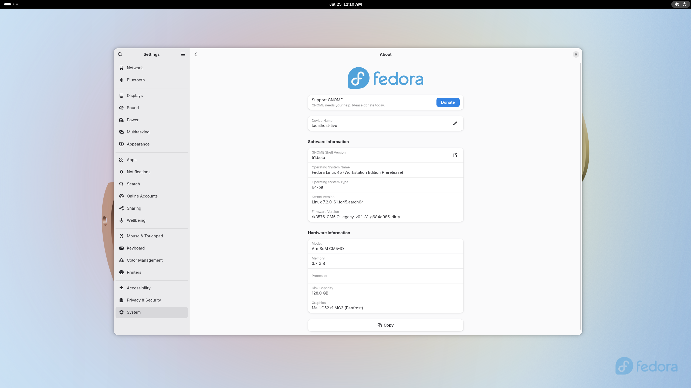

# edk2-rk3576

[English](README.md) | 简体中文

[]()
[](LICENSE)
[](https://flash.gahingwoo.com/)
[](https://edk2.gahingwoo.com/)

Rockchip RK3576 开发板的 UEFI 固件（EDK2 / TianoCore）。它像 PC 一样启动 Linux，三块板子上都能启动
Windows 11 23H2。

```
BootROM -> U-Boot SPL -> TF-A BL31 -> EDK2 (BL33) -> 操作系统
```

| 泰山派 3M 上的 Windows 11 | CM5-IO 上的 Fedora |
|---|---|
|  |  |

## 板子

<!-- generated:boards -->

| 板子 | 构建 | 固件位置 | 映像 |
|---|---|---|---|
| [ArmSoM CM5-IO](docs/boards/cm5io.zh-CN.md) | `cm5io` | eMMC 或 SD 卡 | `CM5IO-emmc-edk2-<版本>.img`, `CM5IO-sdcard-edk2-<版本>.img` |
| [Radxa ROCK 4D](docs/boards/rock4d.zh-CN.md) | `rock4d` | SPI NOR | `ROCK4D-spi-edk2-<版本>.img` |
| [立创泰山派 3M](docs/boards/tspi3m.zh-CN.md) | `tspi3m` | eMMC 或 SD 卡 | `TaishanPi3M-emmc-edk2-<版本>.img`, `TaishanPi3M-sdcard-edk2-<版本>.img` |

<!-- /generated -->

在板子上跑过什么（每种板子只有一块，见[测试](docs/dev/testing.zh-CN.md)）：

- ROCK 4D：Linux（从 NVMe 启动 Fedora），从 NVMe 启动 Windows 11 23H2：GPU、以太网、音频、NPU。
- CM5-IO：Linux（从 NVMe 启动 Fedora），从 eMMC 启动 Windows 11 23H2 能进桌面。
- 泰山派 3M：Windows 11 23H2：GPU、DSI 触摸屏、音频、蓝牙、NPU；Armbian edge [有限制](docs/linux.zh-CN.md#立创泰山派-3m)。

每个构建里有什么：[板子功能](docs/BOARD-FEATURES.zh-CN.md)。泰山派 3M 在 Windows 下的触摸、蓝牙、
音频和 USB-C，以及 ROCK 4D 上的 Windows，需要 [`ci` 构建](docs/flash.zh-CN.md#滚动的-ci-构建)，0.4.1 正式版没有。串口：1500000 8N1。

## 上手

1. 下载映像：[最新正式版](https://github.com/gahingwoo/edk2-rk3576/releases/latest)（0.4.1），
   或 `main` 的 [`ci` 构建](docs/flash.zh-CN.md#滚动的-ci-构建)。
2. 写入（见[刷写固件](docs/flash.zh-CN.md)）：用 [Maskrom Studio](https://github.com/gahingwoo/maskrom-studio)、
   [flash.gahingwoo.com](https://flash.gahingwoo.com/)（Chrome 或 Edge）或 `rkdeveloptool`。
3. 装系统：[Windows](docs/windows.zh-CN.md)（只能用 23H2，RK3576 是 ARMv8.0）或 [Linux](docs/linux.zh-CN.md)。用 Armbian 自己的 U-Boot、从启动管理器启动一次：[Armbian (U-Boot)](docs/armbian-boot.zh-CN.md)。
4. 遇到问题：[故障排查](docs/troubleshooting.zh-CN.md)、[已知问题](docs/known-issues.zh-CN.md)。

固件功能（中文菜单、截图、调试报告、恢复全部设置、NTP 校时、屏幕键盘）见[固件菜单](docs/firmware-menus.zh-CN.md)。
图片见[图片展示](docs/gallery.zh-CN.md)。

## 相关项目

| 仓库 | 内容 |
|---|---|
| [woa-rk3576](https://github.com/gahingwoo/woa-rk3576) | Windows 驱动和 WinPE 安装映像 |
| [wddm-mali-g52](https://github.com/gahingwoo/wddm-mali-g52) | Mali-G52 的 Windows GPU 和显示驱动 |
| [woa-rk3576-npu](https://github.com/gahingwoo/woa-rk3576-npu) | Windows NPU 驱动和 charsiu 大模型运行时 |
| [maskrom-studio](https://github.com/gahingwoo/maskrom-studio) | 桌面程序：写固件、不用 U 盘装 Windows、恢复 Armbian 或出厂系统 |
| [edk2-webflash](https://github.com/gahingwoo/edk2-webflash) | flash.gahingwoo.com 网页刷机工具 |

## 编译

```bash
scripts/setup-host.sh
scripts/build.sh   cm5io      # 或 rock4d、tspi3m
scripts/package.sh cm5io      # 输出到 out/CM5IO/
```

开发文档：[编译](docs/dev/building.zh-CN.md)、[架构](docs/dev/architecture.zh-CN.md)、[映像布局](docs/dev/image-layout.zh-CN.md)、
[硬件](docs/dev/hardware.zh-CN.md)、[ACPI](docs/dev/acpi.zh-CN.md)、[测试](docs/dev/testing.zh-CN.md)、[发布](docs/dev/releasing.zh-CN.md)、
[核心补丁](patches/README.zh-CN.md)、[历史记录](docs/history/README.md)。

## 致谢

感谢[嘉立创](https://jlc.com/)（JLC）赞助立创泰山派 3M、MIPI DSI 屏、风扇和 EC20 4G 模块，
感谢 [ArmSoM](https://www.armsom.org/) 赞助 CM5 核心板和 CM5-IO 底板。

## 许可证

BSD-2-Clause-Patent，与 TianoCore 和 edk2-rockchip 相同。取自 Linux、U-Boot 和 Rockchip 的代码保留各自的许可证，[LICENSE](LICENSE) 里列出了这些文件。
