# Gallery

English | [简体中文](gallery.zh-CN.md)

## Operating systems

| | |
|---|---|
| 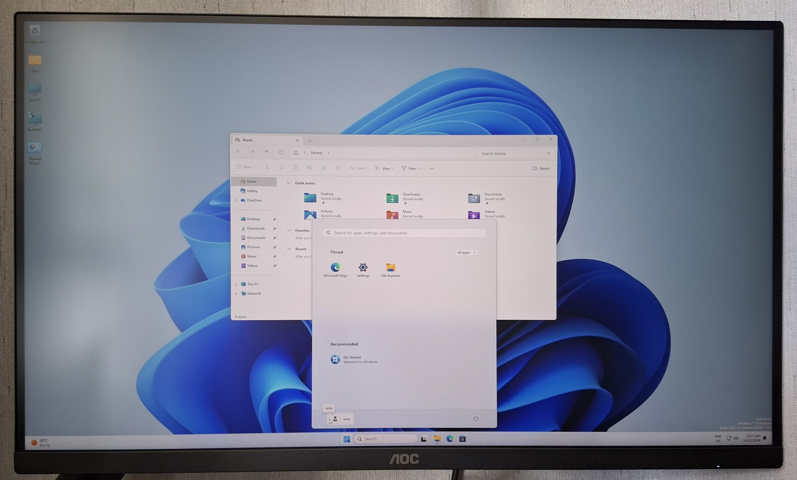 | Windows 11 23H2 on the LCKFB TaishanPi 3M, from the eMMC. The desktop is drawn on the Mali-G52 by [wddm-mali-g52](https://github.com/gahingwoo/wddm-mali-g52). |
| 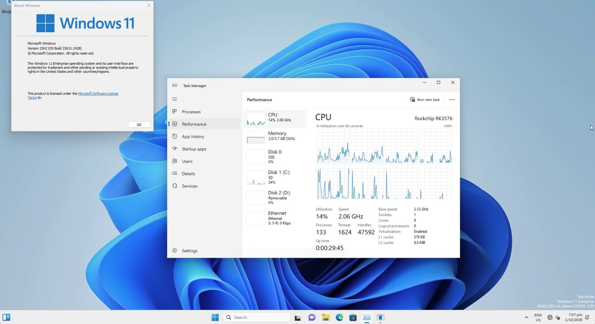 | Windows 11 23H2 on the ArmSoM CM5-IO, from the eMMC: eight cores, 3.7 GB, the eMMC as C:, the NVMe, the SD card, Ethernet and both USB controllers. |
| 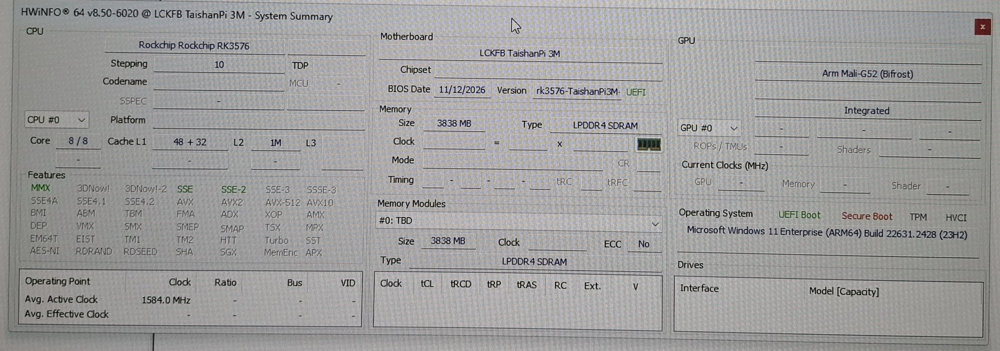 | HWiNFO on the TaishanPi 3M under Windows: eight cores, 3838 MB, the board and firmware names from SMBIOS, the Mali-G52. |
| 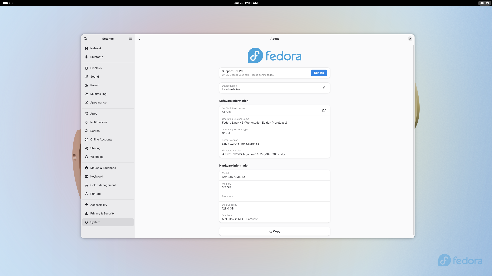 | GNOME About on the CM5-IO: Fedora 45 Workstation, kernel 7.2, 3.7 GiB, Mali-G52 through Panfrost. |
| 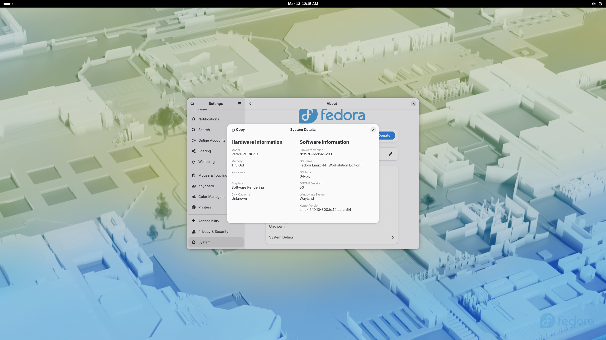 | GNOME About on the Radxa ROCK 4D: Fedora 44, 11.5 GiB. |
| 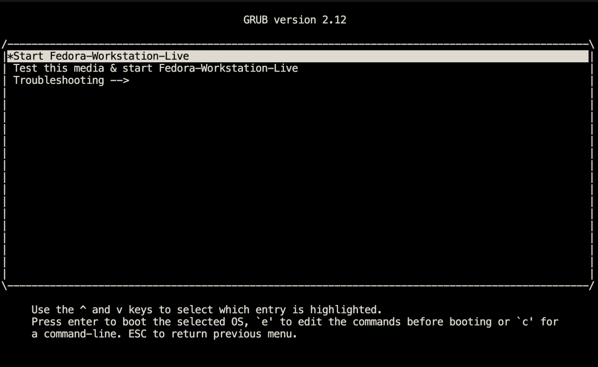 | GRUB from a Fedora USB stick. |
| 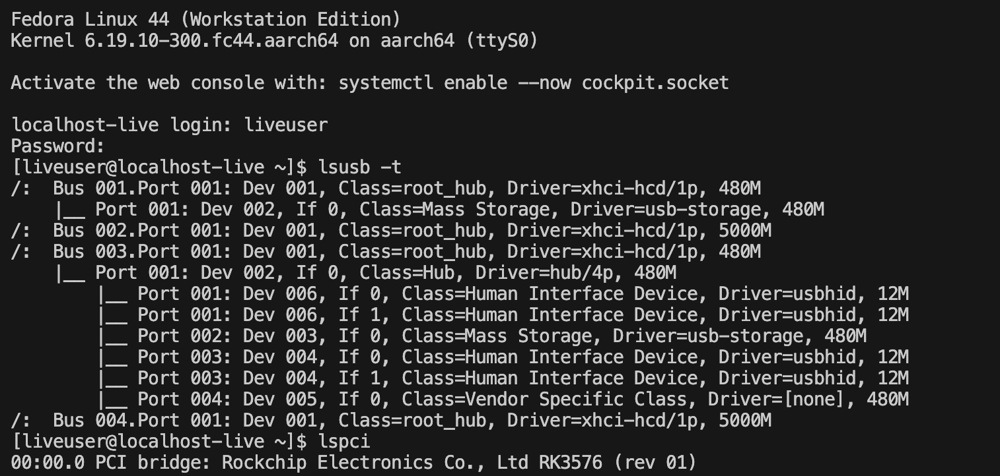 | Fedora live console. |

## Firmware

| | |
|---|---|
|  | Front page on the ROCK 4D, 2560x1440 over HDMI. |
| 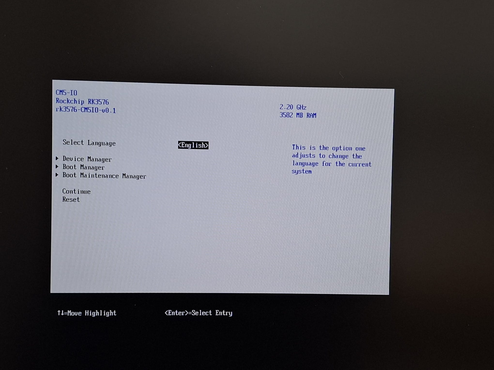 | Front page on the CM5-IO, 2560x1440 over HDMI. |
| 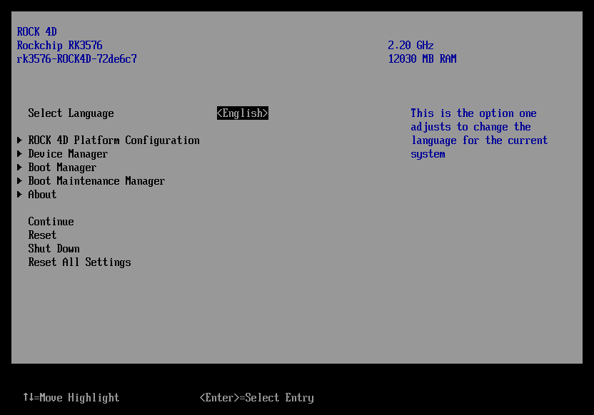 | Front page on the ROCK 4D, from an older build, saved by the firmware itself (F12). Platform configuration is the first entry. |
| 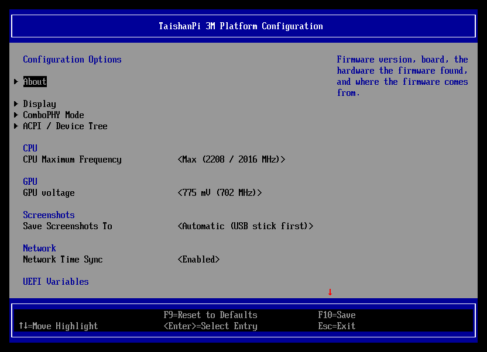 | Platform configuration on the TaishanPi 3M, 0.5.0: About, Display, ComboPHY, ACPI / Device Tree, CPU clock, GPU voltage, screenshots, network time, UEFI variables. |
| 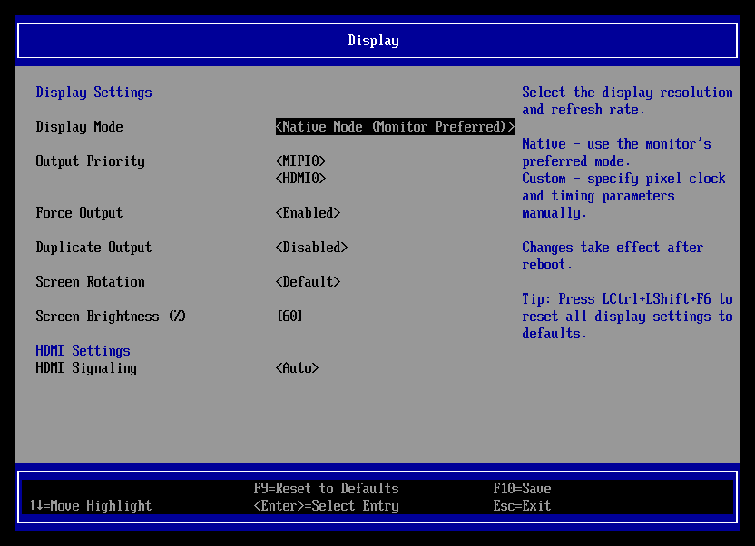 | Display settings: mode, output priority (MIPI, HDMI), forced and duplicate output, rotation, brightness, HDMI signaling. |
| 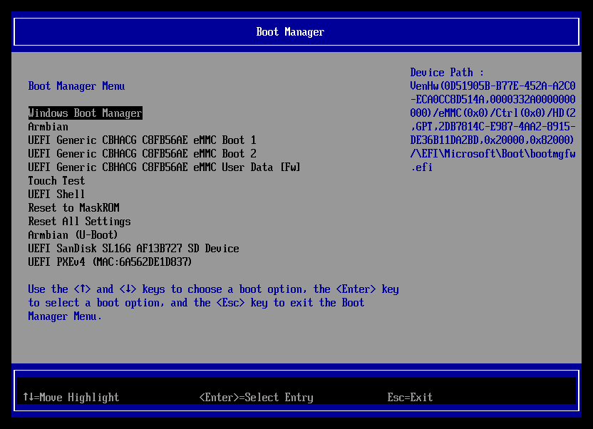 | Boot Manager on the TaishanPi 3M: Windows, Armbian, the eMMC, Touch Test, UEFI Shell, MaskROM, Reset All Settings, Armbian (U-Boot), SD card, network. |
| 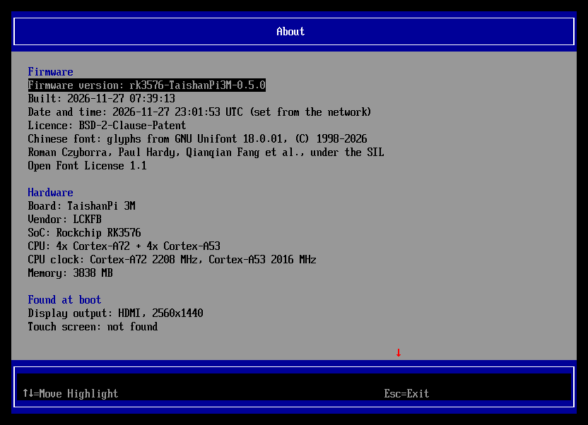 | About: firmware version and build time, clock set from the network, board, CPU clocks, memory, what was found at boot. |
