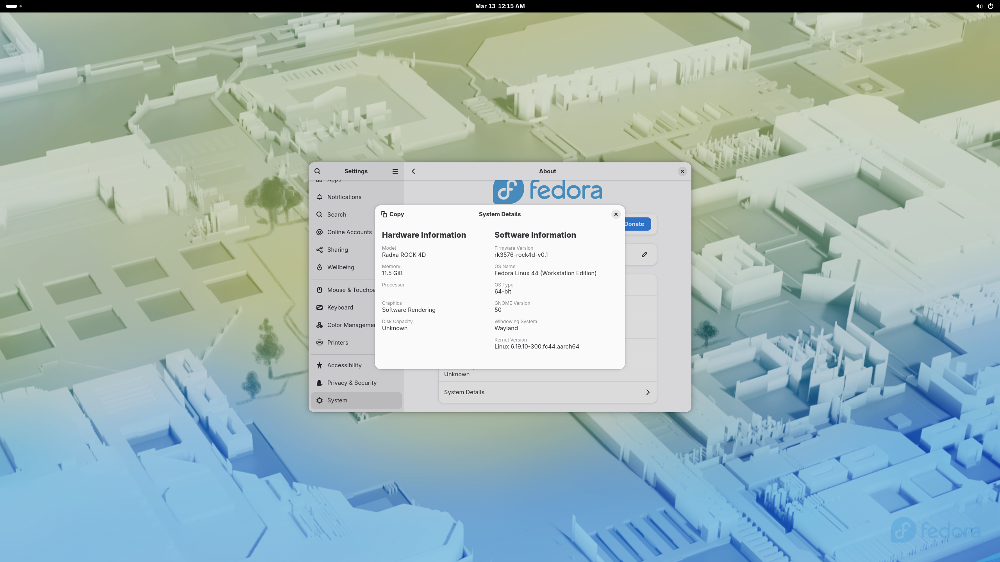
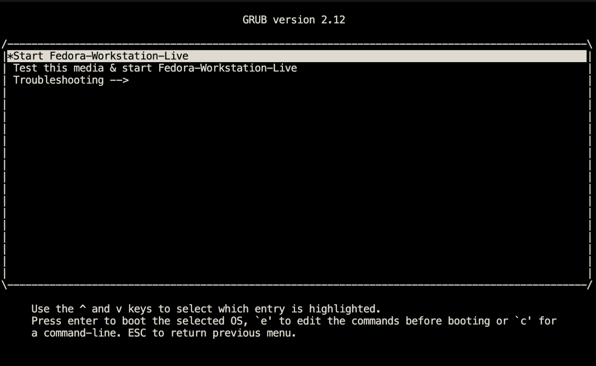
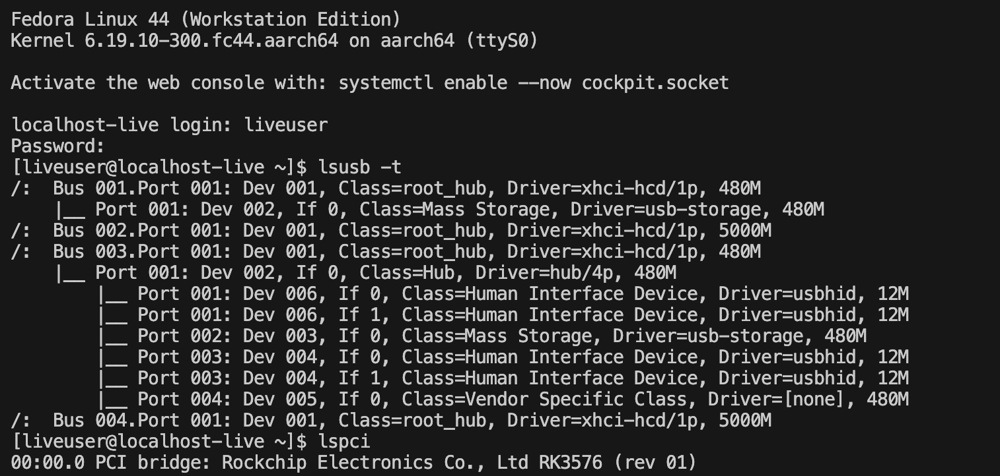
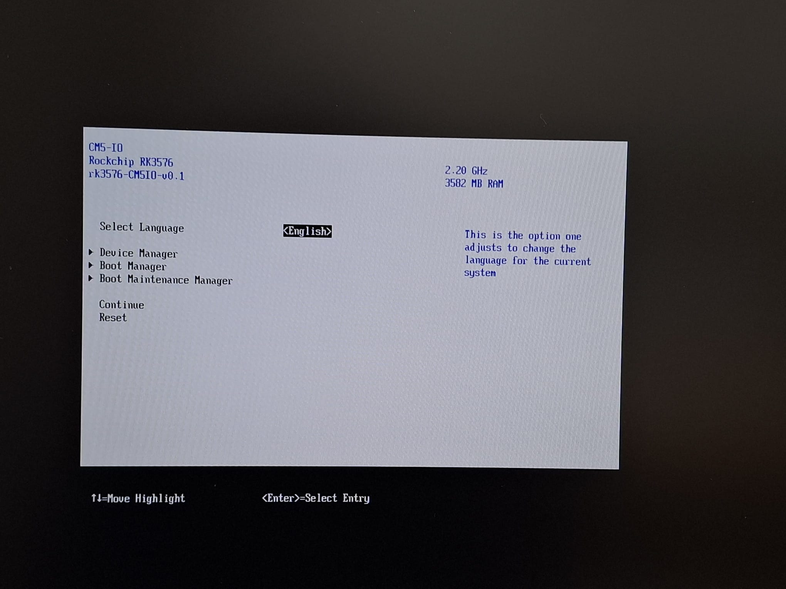
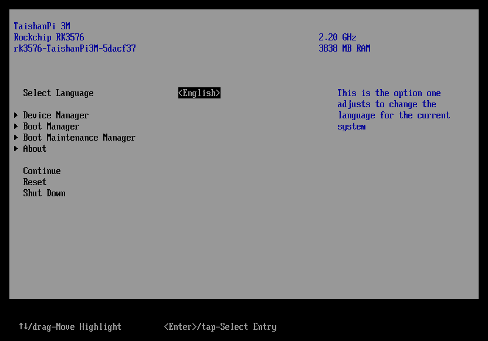
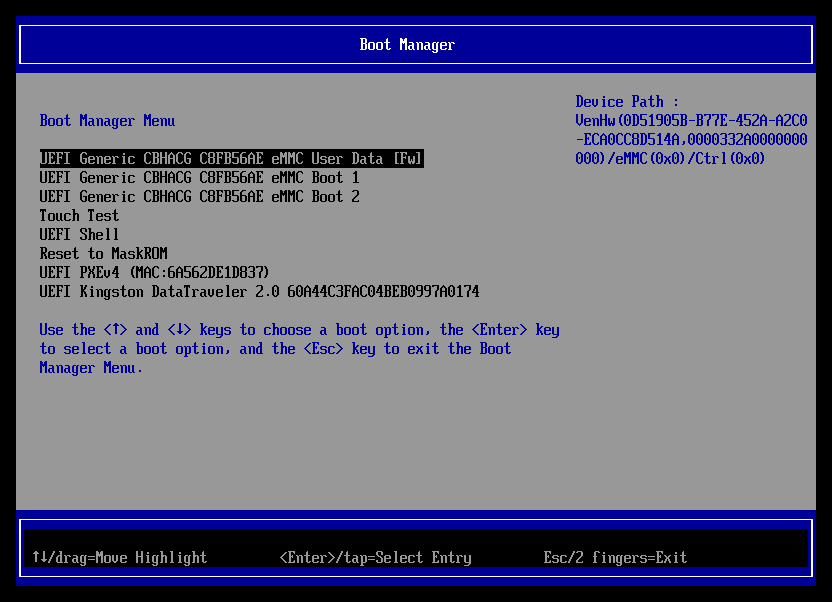
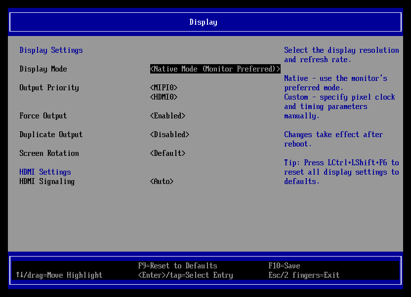

# 图片展示

[English](gallery.md) | 简体中文

## 操作系统

| | |
|---|---|
|  | 立创泰山派 3M 从 eMMC 启动的 Windows 11 23H2。桌面由 [wddm-mali-g52](https://github.com/gahingwoo/wddm-mali-g52) 在 Mali-G52 上绘制。 |
|  | ArmSoM CM5-IO 从 eMMC 启动的 Windows 11 23H2：八个核心、3.7 GB 内存，eMMC 作为 C: 盘，NVMe、SD 卡、以太网和两个 USB 控制器都能用。 |
|  | 泰山派 3M 上 Windows 里的 HWiNFO：八个核心、3838 MB 内存，来自 SMBIOS 的板子和固件名称，以及 Mali-G52。 |
|  | CM5-IO 上 GNOME 的"关于"页面：Fedora 45 Workstation，内核 7.2，3.7 GiB 内存，Mali-G52 走 Panfrost 驱动。 |
|  | Radxa ROCK 4D 上 GNOME 的"关于"页面：Fedora 44，11.5 GiB 内存。 |
|  | 从 Fedora U 盘启动的 GRUB。 |
|  | Fedora live 系统的控制台。 |

## 固件

| | |
|---|---|
|  | ROCK 4D 上的首页，通过 HDMI 输出 2560x1440。 |
|  | CM5-IO 上的首页，通过 HDMI 输出 2560x1440。 |
|  | 泰山派 3M 的首页，带 Shut Down（关机）和 About（关于），由固件自己截图保存。竖屏面板上的菜单按横屏方向绘制。 |
|  | 同一个首页的简体中文版。 |
|  | About（关于）：固件构建、板子、时钟，以及启动时找到的设备。 |
|  | Boot Manager（启动管理器）：eMMC、Touch Test、UEFI Shell、MaskROM、网络启动、一个 U 盘。 |
|  | 平台配置。 |
|  | 显示设置。 |
