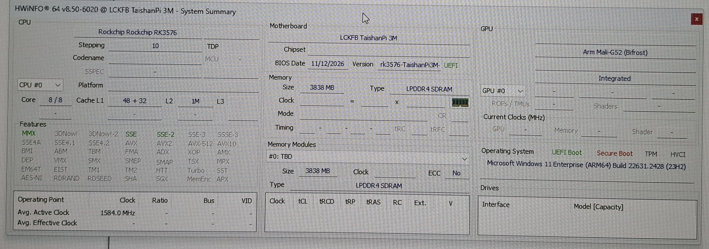
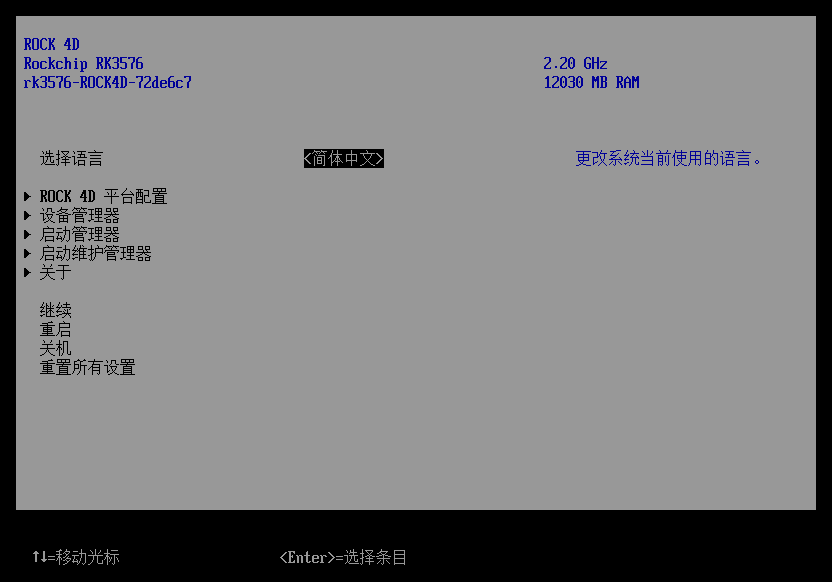
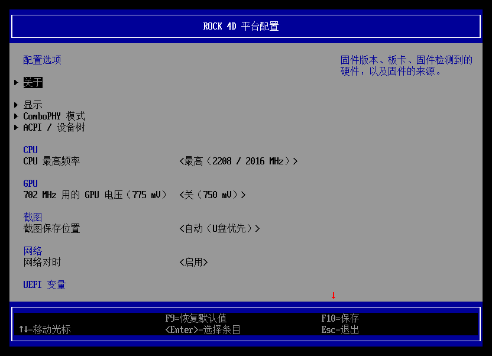
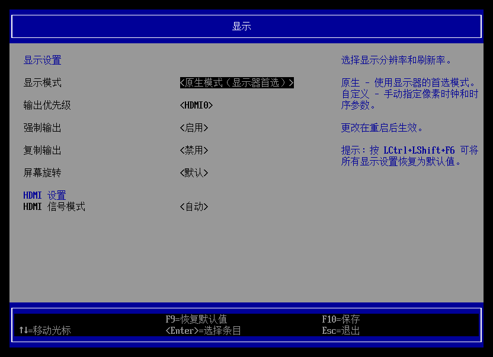
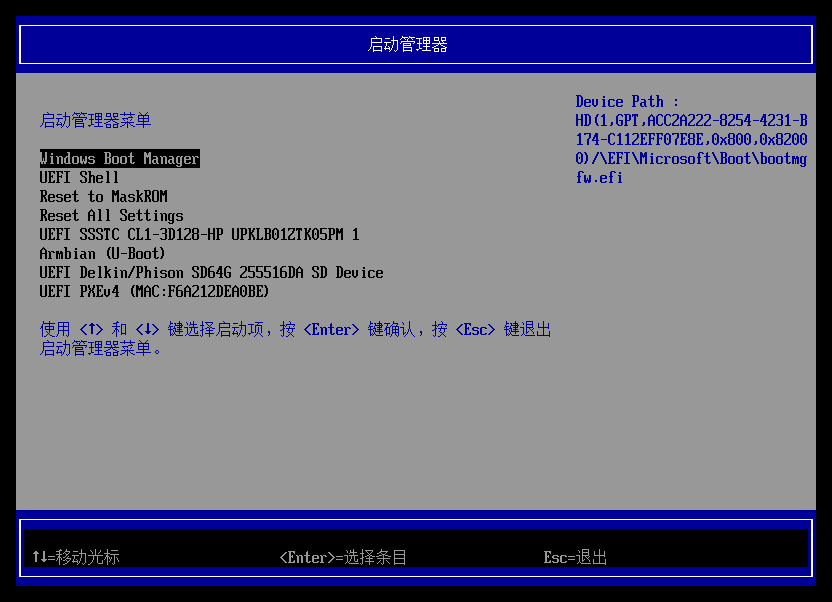

# 图片展示

[English](gallery.md) | 简体中文

## 操作系统

| | |
|---|---|
|  | 立创泰山派 3M 从 eMMC 启动的 Windows 11 23H2。桌面由 [wddm-mali-g52](https://github.com/gahingwoo/wddm-mali-g52) 在 Mali-G52 上绘制。 |
|  | ArmSoM CM5-IO 从 eMMC 启动的 Windows 11 23H2：八个核心、3.7 GB 内存，eMMC 作为 C: 盘，NVMe、SD 卡、以太网和两个 USB 控制器都能用。 |
|  | 泰山派 3M 上 Windows 里的 HWiNFO：八个核心、3838 MB 内存，来自 SMBIOS 的板子和固件名称，以及 Mali-G52。 |
|  | CM5-IO 上 GNOME 的"关于"页面：Fedora 45 Workstation，内核 7.2，3.7 GiB 内存，Mali-G52 走 Panfrost 驱动。 |
|  | Radxa ROCK 4D 上 GNOME 的"关于"页面：Fedora 44，11.5 GiB 内存。 |
|  | 从 Fedora U 盘启动的 GRUB。 |
|  | Fedora live 系统的控制台。 |

## 固件

| | |
|---|---|
|  | ROCK 4D 上的首页，通过 HDMI 输出 2560x1440。 |
|  | CM5-IO 上的首页，通过 HDMI 输出 2560x1440。 |
|  | ROCK 4D 的首页，由固件自己截图保存（F12）。平台配置是第一项。 |
|  | 平台配置：关于、显示、ComboPHY、ACPI / 设备树、CPU 频率、GPU 电压、截图、网络对时。 |
|  | 显示设置。 |
|  | 启动管理器：Windows、UEFI Shell、MaskROM、Reset All Settings（重置所有设置）、NVMe、Armbian (U-Boot)、SD 卡、网络启动。 |
|  | 关于：固件构建、板子、时钟，以及启动时找到的设备。 |
