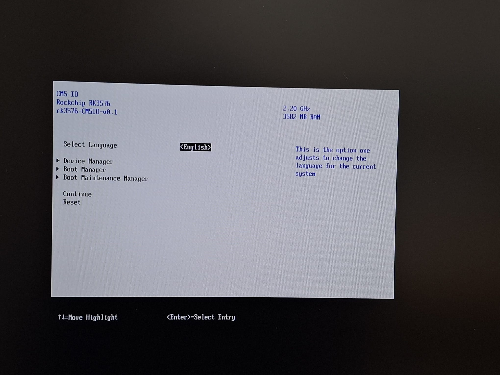
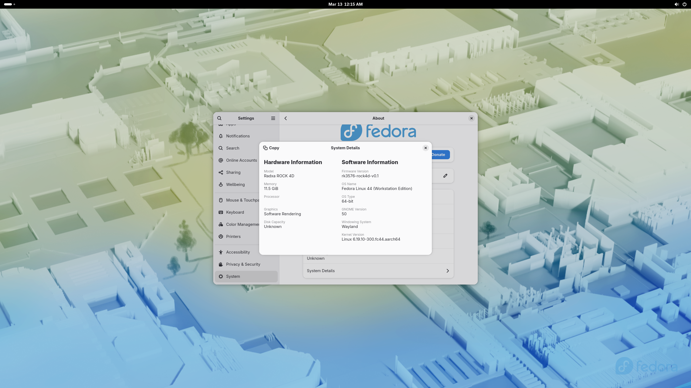
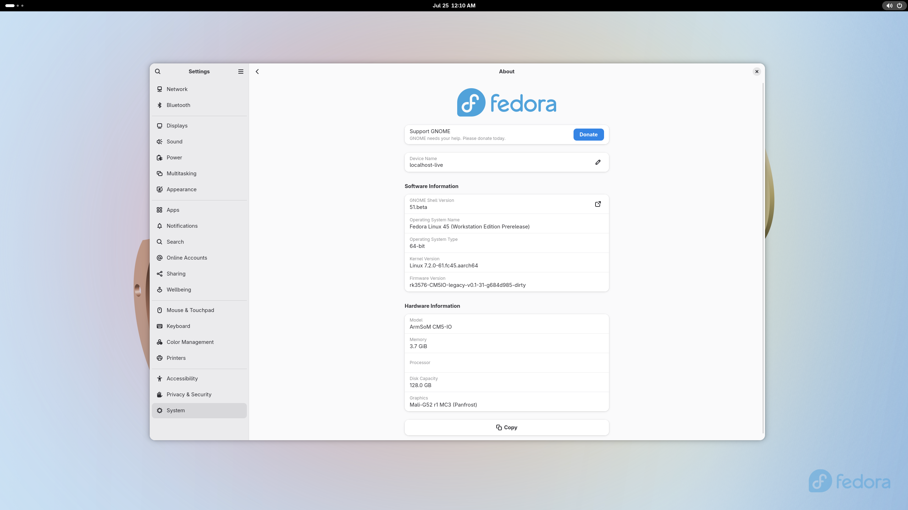
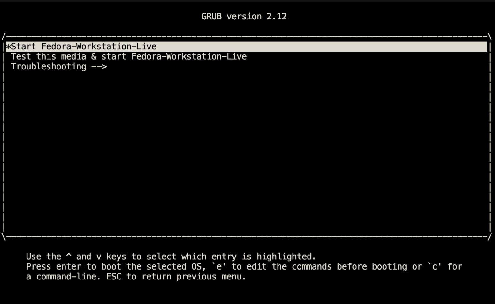
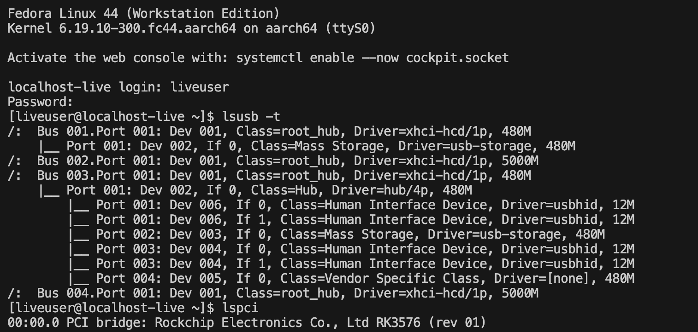
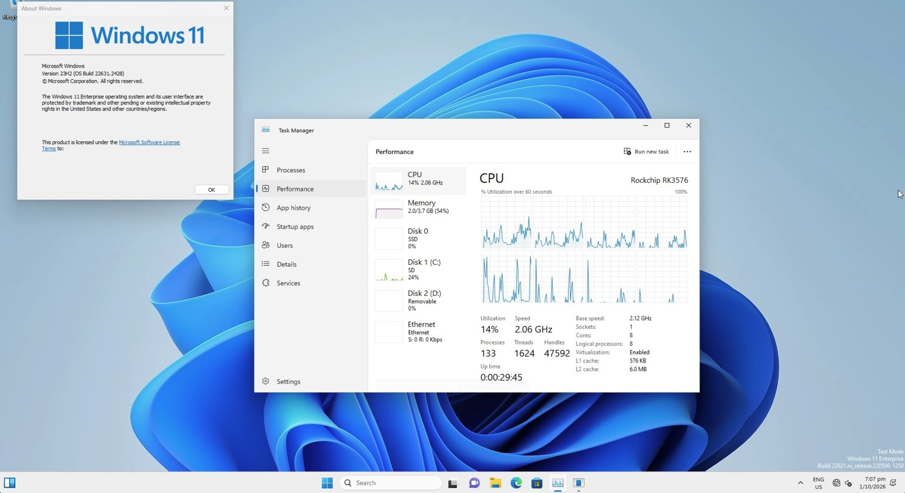
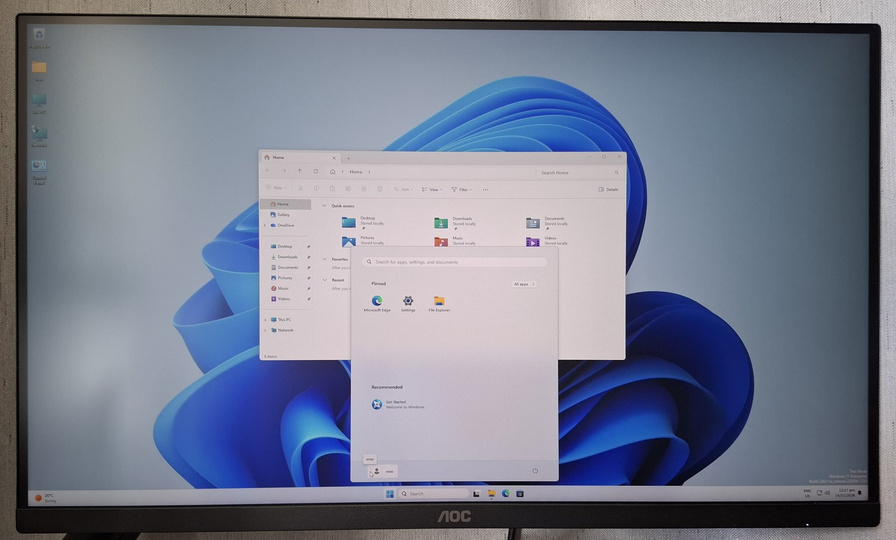
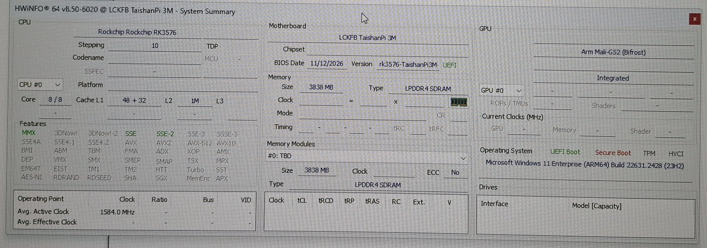

# edk2-rk3576

UEFI firmware (EDK2 / TianoCore) for Rockchip RK3576 boards: Radxa ROCK 4D,
ArmSoM CM5-IO and LCKFB TaishanPi 3M.

```
BootROM → U-Boot SPL → TF-A BL31 → EDK2 (BL33) → OS
```

The ROCK 4D and the CM5-IO boot Fedora from NVMe. The CM5-IO and the
TaishanPi 3M boot Windows 11 23H2 from their eMMC;
[how to install it](https://github.com/gahingwoo/edk2-rk3576#windows).

## Get it

- Images: [latest release](https://github.com/gahingwoo/edk2-rk3576/releases/latest)
- Flash from the browser: [flash.gahingwoo.com](https://flash.gahingwoo.com/)
- Source, board status and known issues: [github.com/gahingwoo/edk2-rk3576](https://github.com/gahingwoo/edk2-rk3576#boards)

## Screenshots

| Radxa ROCK 4D | ArmSoM CM5-IO |
|---|---|
|  |  |
| TianoCore front page, 2560×1440@60 over HDMI | TianoCore front page, 2560×1440@60 over HDMI |
|  |  |
| GNOME *About*: Fedora 44, 11.5 GiB RAM | GNOME *About*: Fedora 45 Workstation, kernel 7.2, 3.7 GiB RAM, Mali-G52 via Panfrost |

| | |
|---|---|
|  |  |
| GRUB from a Fedora USB stick | Fedora live console |



Windows 11 23H2 on CM5-IO, booted from the eMMC: eight cores, 3.7 GB, the eMMC
as C:, the NVMe, the SD card, Ethernet and both USB controllers. The drivers
are in [woa-rk3576](https://github.com/gahingwoo/woa-rk3576).



Windows 11 23H2 on the TaishanPi 3M, booted from the eMMC. The desktop in
this photo is drawn on the Mali-G52 by
[wddm-mali-g52](https://github.com/gahingwoo/wddm-mali-g52).



HWiNFO on the TaishanPi 3M under Windows.

## Docs

- [Flashing](FLASHING.md): the browser tool, `rkdeveloptool`, SD card and eMMC
- [Building](BUILDING.md): host setup, dependencies, the three build scripts
- [Image layout](SPI_LAYOUT.md): byte offsets in each image, and the FIT
- [Hardware](HARDWARE.md): the board facts the firmware depends on
