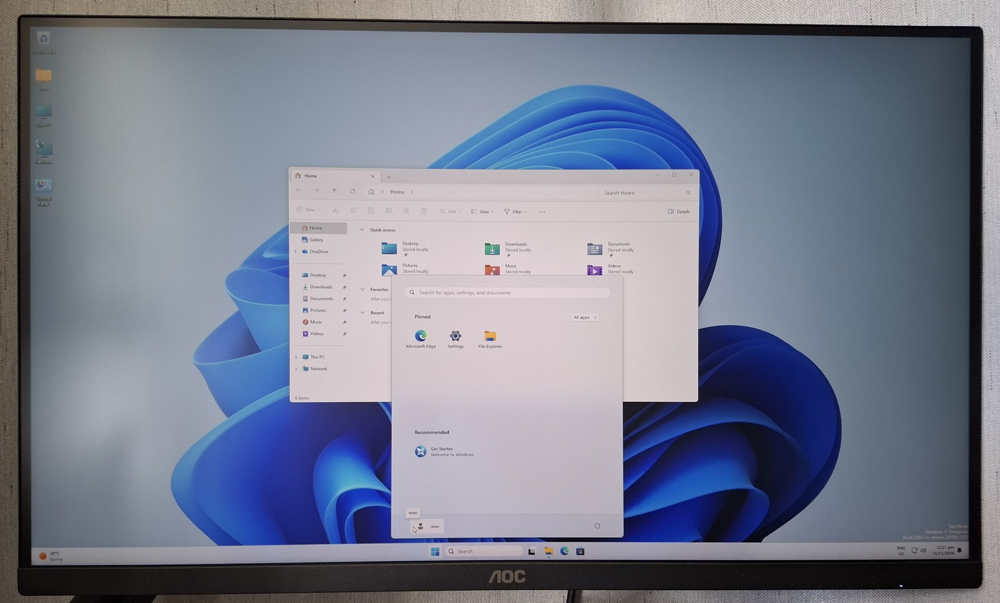

# edk2-rk3576

English | [简体中文](index.zh-CN.md)

UEFI firmware (EDK2 / TianoCore) for Rockchip RK3576 boards: Radxa ROCK 4D,
ArmSoM CM5-IO and LCKFB TaishanPi 3M.

```
BootROM -> U-Boot SPL -> TF-A BL31 -> EDK2 (BL33) -> OS
```



## From a new board to Windows or Linux

1. Read your board's page: [Radxa ROCK 4D](boards/rock4d.md),
   [ArmSoM CM5-IO](boards/cm5io.md), [LCKFB TaishanPi 3M](boards/tspi3m.md).
2. Write the firmware: [flashing](flash.md). The easiest ways are
   [Maskrom Studio](https://github.com/gahingwoo/maskrom-studio) and
   [flash.gahingwoo.com](https://flash.gahingwoo.com/).
3. Windows 11 23H2 (all three boards): [Windows](windows.md).
4. Linux: [Linux](linux.md). Armbian with its own U-Boot, once from the
   boot manager: [Armbian (U-Boot)](armbian-boot.md).
5. Something wrong: [troubleshooting](troubleshooting.md),
   [known issues](known-issues.md).

## Get it

- Images: [latest release](https://github.com/gahingwoo/edk2-rk3576/releases/latest),
  or the [`ci` build](flash.md#the-rolling-ci-build) of `main`
- Flash from the browser: [flash.gahingwoo.com](https://flash.gahingwoo.com/)
- Source: [github.com/gahingwoo/edk2-rk3576](https://github.com/gahingwoo/edk2-rk3576)

## Pages

- [Firmware menus and features](firmware-menus.md): language, screenshots,
  debug report, Reset All Settings, clock, display, touch, OS options
- [Board features](BOARD-FEATURES.md): what each board's build contains
  (generated from the build)
- [Settings reference](settings.md): every setup option, its UEFI variable
  and its default per board (generated)
- [Gallery](gallery.md)
- For developers: [building](dev/building.md), [architecture](dev/architecture.md),
  [image layout](dev/image-layout.md), [hardware](dev/hardware.md),
  [ACPI](dev/acpi.md), [testing](dev/testing.md), [releasing](dev/releasing.md)
- [History](history/README.md): dated notes kept as written

## Related projects

| Repository | What |
|---|---|
| [woa-rk3576](https://github.com/gahingwoo/woa-rk3576) | Windows drivers and the WinPE install image |
| [wddm-mali-g52](https://github.com/gahingwoo/wddm-mali-g52) | Windows GPU and display driver for the Mali-G52 |
| [woa-rk3576-npu](https://github.com/gahingwoo/woa-rk3576-npu) | Windows NPU driver and the charsiu LLM runtime |
| [maskrom-studio](https://github.com/gahingwoo/maskrom-studio) | Desktop app: firmware, Windows without a USB stick, back to Armbian or the factory image |
| [edk2-webflash](https://github.com/gahingwoo/edk2-webflash) | The browser flasher at flash.gahingwoo.com |
